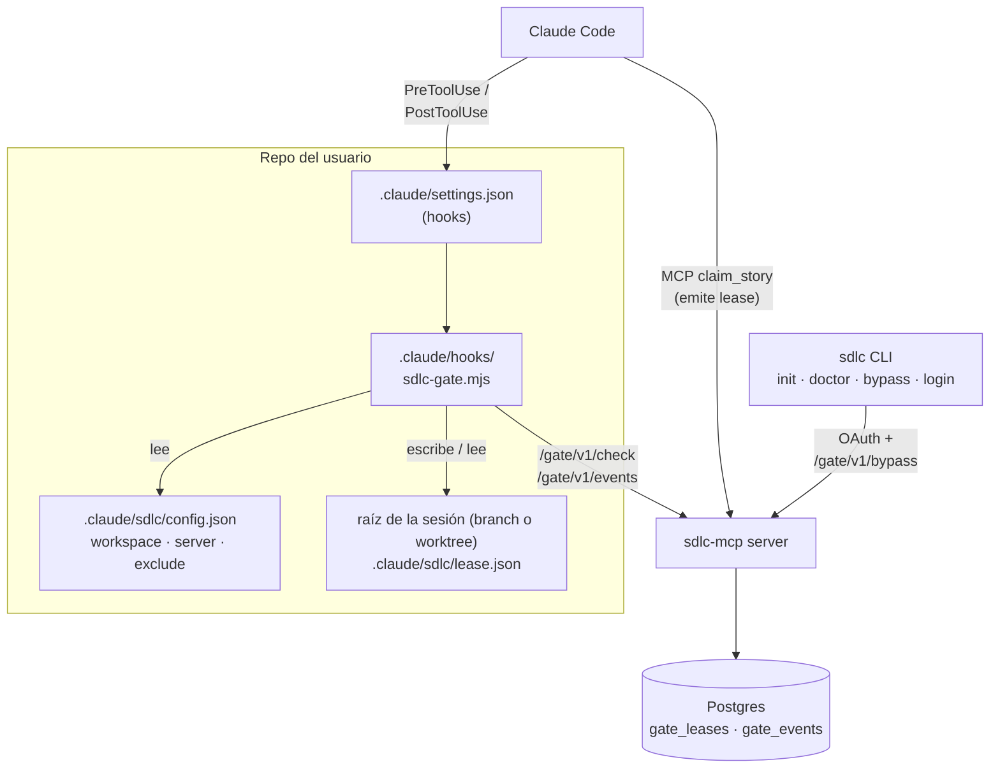

# RFC: Activar el SDLC obligatorio en un repositorio en un solo paso

**Autores:** vazquez.n.g@gmail.com
**Fecha:** 2026-11-23
**Estado:** draft
**PRD origen:** https://docs.google.com/document/d/1-LOSABTDEJRN7seOx5LvArTgKdFbkagqEbXRg50BMto/edit?usp=drivesdk

## Context

El PRD pide que habilitar un repositorio para el SDLC obligatorio deje de ser una configuración artesanal de ~2 h y pase a ser un asistente de terminal de ≤ 10 min. A partir de ahí, ningún cambio de Claude Code en ese repo puede llegar a un commit sin una historia sdlc activa, un bypass registrado o una ruta excluida.

La referencia es el gate manual de kanso (`.claude/hooks/sdlc_gate.py`). Además de no estar empaquetado, revisarlo mostró tres fallos que el diseño tiene que cerrar:

1. El hook `PostToolUse` escribe la marca de historia activa **sin mirar si `claim_story` respondió `ok`**: un claim rechazado abre el gate igual.
2. La marca es un archivo local. El agente la puede escribir con Bash (`echo '{}' > .claude/sdlc-activo.json`), porque el gate sólo protege Edit/Write.
3. El gate exime `.claude/` completo, así que el agente puede editar `.claude/settings.json` y sacar sus propios hooks.

A eso se suma que una sola marca por repo impide trabajar en paralelo (REQ-9).

## Architecture context

Esta feature se apoya en el server existente y suma un paquete CLI nuevo dentro del mismo monorepo.

### Architecture mode

`hybrid`. Hay una parte nueva: un paquete CLI (`packages/cli`) con el asistente `init`, `doctor`, `login`, `bypass` y el gate que se instala en el repo del usuario. Hay otra parte que extiende el server existente: `claim_story` pasa a emitir un *lease* y aparece una API HTTP `/gate/v1/*` para validar leases y registrar eventos.

No se puede resolver sólo del lado cliente: según las decisiones tomadas, la historia activa tiene que verificarla el server para que el agente no pueda falsificarla, y el registro de bypass y bloqueos tiene que ser central para medir la North Star.

### Existing components reused

- `apps/server/src/mcp/tools/claim-story.ts`: se extiende para emitir el lease.
- `apps/server/src/auth/oauth-bearer.ts` (`createOAuthBearerAuth`): autentica las rutas `/gate/v1/*` con el mismo access token del AS propio.
- `apps/server/src/oauth/*`: authorization server OAuth 2.1 + PKCE + Google SSO. El CLI hace login contra él igual que cualquier cliente MCP (registro dinámico, redirect loopback).
- `apps/server/src/mcp/tools/workspace-access.ts` / `flow-access.ts`: guardas de membresía de workspace, reusadas en las rutas del gate.
- `apps/server/src/stories/transitions.ts`: la FSM de stories define qué statuses cuentan como "activa".
- `FlowStore` (in-memory + Postgres) y el runner de migraciones (`apps/server/migrations`, siguiente: `0014`).
- Telemetría existente (pino + OpenTelemetry).
- Claude Code: hooks `PreToolUse`/`PostToolUse` y la convención de worktrees en `.claude/worktrees/` (la que usan `EnterWorktree` / `claude --worktree`).

### Codebase context

- Monorepo pnpm + turbo, TypeScript ESM, Node ≥ 20, tests con vitest y límites de dependencias con dependency-cruiser (`.dependency-cruiser.cjs`).
- Paquete nuevo `packages/cli` (`@sdlc/cli` en el workspace; el nombre público en npm queda como Open Question). Depende de `@sdlc/core` para los tipos y de nada del server: habla con el server sólo por HTTP.
- El gate se compila con esbuild a **un único archivo `.mjs` sin dependencias** (`packages/cli/dist/gate.mjs`). `init` lo copia al repo destino como `.claude/hooks/sdlc-gate.mjs`, versionado y commiteado, para que el hook no dependa de `npx` ni de la red para arrancar.
- Server: ruta nueva en `apps/server/src/gate/` (routes + store), registrada en `src/index.ts` junto a `registerAdminRoutes`. Migración `0014_gate.sql`.
- Mensajes al usuario en español, igual que las tools actuales.

### Integration points

- **`claim_story` (MCP)**: agrega `data.gate_lease: { lease_id: string; expires_at: string }` a la respuesta, tanto en la primera respuesta como en la idempotente. Es aditivo y los clientes actuales lo ignoran.
- **Hook `PostToolUse` sobre `mcp__sdlc__claim_story`**: lee `tool_response` y escribe `.claude/sdlc/lease.json` en la raíz de la sesión (checkout principal o worktree) **sólo si** la respuesta es `ok:true` y trae `gate_lease`.
- **`POST /gate/v1/check`** (gate → server): valida el lease contra la raíz de la sesión y la branch actuales.
- **`POST /gate/v1/events`** (gate → server): registra commits permitidos o bloqueados y ediciones bloqueadas.
- **`POST /gate/v1/bypass`** (CLI humano → server): crea un lease de tipo `bypass` con motivo y TTL.
- **`GET /gate/v1/workspaces/:id/summary`** (CLI `doctor`, futuro panel): agrega los eventos para la North Star.
- **Credenciales**: el CLI guarda el token OAuth del usuario en `~/.config/sdlc/credentials.json` (0600), fuera del repo. El gate lo lee para llamar a `/gate/v1/*`.

## Goals

- Habilitar un repositorio con `npx @sdlc/cli init` en ≤ 10 min, sin editar archivos a mano (PRD: métricas 1 y 2).
- Ningún `git commit` de Claude en un repo habilitado sin un lease válido verificado online (o un bypass, o sólo rutas excluidas). El objetivo es 0 fugas a nivel commit.
- Gate en edición con p95 < 200 ms. Con caché caliente < 50 ms, porque no hay llamada de red.
- Un lease activo por branch. Trabajo secuencial en una branch del checkout principal, o N worktrees en paralelo bajo `.claude/worktrees/`. Nunca en la branch default.
- 100% de bypass y bloqueos de commit registrados en el server, con usuario, workspace, repo, branch y motivo.
- Fallar cerrado ante cualquier error del gate: excepción, falta de `node`, server caído o token vencido.

## Non-goals

- Otros agentes e IDEs (OpenCode, Gemini CLI, Codex, VS Code, Antigravity) y otros formatos de hooks.
- Parsear Bash en general para detectar escrituras a archivos. Bash sólo se gatea para `git commit`/`git push` y para comandos que tocan archivos protegidos (ver Security). El commit es la unidad de control y de medición.
- Git hooks (`pre-commit`) para commits humanos desde la terminal.
- Actualizar automáticamente repos ya habilitados: se reejecuta `init`.
- Panel de administración para los eventos del gate: en el MVP se consultan con `doctor`/`summary`.
- Firma asimétrica de leases para verificar offline.

## Design

El diseño tiene tres piezas: el gate que corre en los hooks de Claude Code, el CLI que lo instala y opera, y la API del gate en el server.
El gate decide localmente lo barato (protecciones, exclusiones, ubicación de la sesión) y delega en el server la validez del lease.
Todo error del gate termina en deny.

### Architecture overview


Fuente del diagrama (Mermaid):



**Flujo normal:**

1. El agente crea una branch en el checkout principal (trabajo secuencial) o entra a un worktree en `.claude/worktrees/{slug}` (trabajo en paralelo), y llama a `claim_story`.
2. El server emite un lease ligado a la story y lo devuelve en la respuesta.
3. El hook PostToolUse valida `ok:true` y guarda el lease en `{raíz de la sesión}/.claude/sdlc/lease.json` (el checkout principal o el worktree).
4. En cada Edit/Write/NotebookEdit, el gate:
   - resuelve la raíz de la sesión (checkout principal o worktree) y su branch;
   - aplica las protecciones y las exclusiones;
   - valida el lease (caché de 60 s);
   - deja pasar o deniega con un mensaje que dice el próximo paso.
5. En cada `git commit`/`git push` por Bash, el gate valida el lease **online, sin caché**, y registra el evento.
6. Cuando la story sale de los statuses activos (aprobada, descartada o flow abortado), el server invalida el lease: el próximo check deniega y el gate borra el `lease.json` vencido.

**Gate: orden de evaluación en `PreToolUse`** (cualquier excepción → deny):

1. Ruta destino (Edit/Write) o comando (Bash).
2. Si toca un archivo **protegido**, deny siempre, con o sin lease.
3. Si es Bash y no es `git commit`/`git push`, allow.
4. Si la ruta está fuera del repo, allow.
5. Si la ruta coincide con `exclude` (default + config), allow.
6. Ubicación de la sesión:
   - checkout principal en la branch default (`default_branch` de `config.json`, detectada en `init` desde `origin/HEAD`) → deny ("creá una branch o un worktree");
   - checkout principal en otra branch → sigue (trabajo secuencial, una historia a la vez);
   - worktree bajo `{repo}/.claude/worktrees/` → sigue (trabajo en paralelo);
   - worktree en cualquier otra ruta → deny ("los worktrees van en .claude/worktrees/").
7. Si no hay `lease.json`, deny ("reclamá una historia con claim_story").
8. `check`: el server valida el lease y lo ata (o compara) a la branch. Si no es válido, deny.
9. Allow. Si era un commit, se registra el evento `commit.allowed`.

**Hook en `.claude/settings.json`** (lo escribe `init`):

```json
{
  "hooks": {
    "PreToolUse": [
      { "matcher": "Edit|Write|NotebookEdit|Bash",
        "hooks": [{ "type": "command",
          "command": "node \"$CLAUDE_PROJECT_DIR/.claude/hooks/sdlc-gate.mjs\" pre || exit 2" }] }
    ],
    "PostToolUse": [
      { "matcher": "mcp__sdlc__claim_story",
        "hooks": [{ "type": "command",
          "command": "node \"$CLAUDE_PROJECT_DIR/.claude/hooks/sdlc-gate.mjs\" post || exit 2" }] }
    ]
  }
}
```

El `|| exit 2` cubre el caso de que falte `node` o el script reviente antes de emitir JSON. Para Claude Code, `exit 2` en PreToolUse es un bloqueo; cualquier otro código distinto de cero no bloquea. El deny normal sale por stdout (`permissionDecision: "deny"`) con `exit 0`.

**CLI `init` (interactivo)**:

1. Detecta la raíz git.
2. Pide la URL del server (default `http://localhost:3100`) y hace login OAuth si no hay credencial.
3. Lista los workspaces del usuario (`whoami`) y le pide **elegir uno explícitamente**.
4. Pide exclusiones extra, partiendo del default.
5. Muestra un diff de cada archivo que va a tocar y pide confirmar.
6. Escribe: `.mcp.json` (merge, entrada `sdlc` tipo `http` con la URL, sin rutas absolutas), `.claude/settings.json` (merge de hooks y deny rules), `.claude/hooks/sdlc-gate.mjs`, `.claude/sdlc/config.json`, `.gitignore` (`.claude/sdlc/lease.json`, `.claude/sdlc/cache.json`, `.claude/worktrees/`) y una sección marcada `<!-- sdlc:begin --> … <!-- sdlc:end -->` en `CLAUDE.md`.
7. Corre `doctor`.

Reejecutarlo es idempotente: hace merge por claves y reemplaza sólo los bloques marcados (REQ-14).

**CLI `doctor`** (REQ-13):

- Verifica `node` ≥ 20, la versión del gate y los hooks presentes en `.claude/settings.json`.
- Revisa `disableAllHooks` en `~/.claude/settings.json`, `.claude/settings.local.json` y los managed settings, y cualquier hook o permiso que contradiga el gate.
- Verifica que el server responda, que el token sea válido y que el usuario sea miembro del workspace.
- Hace un *dry-run* del gate con eventos sintéticos: Edit sin lease → deny, ruta excluida → allow, commit sin lease → deny, server inaccesible → deny.
- Sale con código ≠ 0 si algo falla.

**CLI `bypass`** (REQ-8):

- Uso: `sdlc bypass --reason "texto" [--ttl 30m]`.
- Exige TTY interactivo y una confirmación tipeada. Crea en el server un lease `kind=bypass` (TTL máx. 2 h) ligado a la branch actual y lo escribe en `lease.json`.
- Queda registrado con actor, motivo, repo, branch y expiración.

### Data model

```sql
-- 0014_gate.sql
CREATE TABLE gate_leases (
  lease_hash      text PRIMARY KEY,          -- sha256(lease_id); el secreto no se persiste
  tenant_id       text NOT NULL,
  workspace_id    text NOT NULL,
  kind            text NOT NULL CHECK (kind IN ('story','bypass')),
  story_id        text,                      -- NOT NULL si kind='story'
  flow_id         text,
  user_id         text NOT NULL,
  repo            text,                      -- remote normalizado, fijado en el primer check
  branch          text,                      -- fijado en el primer check (TOFU)
  reason          text,                      -- obligatorio si kind='bypass'
  created_at      timestamptz NOT NULL DEFAULT now(),
  expires_at      timestamptz NOT NULL,
  revoked_at      timestamptz
);
CREATE INDEX gate_leases_story ON gate_leases (story_id) WHERE revoked_at IS NULL;

CREATE TABLE gate_events (
  id              bigserial PRIMARY KEY,
  tenant_id       text NOT NULL,
  workspace_id    text NOT NULL,
  user_id         text NOT NULL,
  repo            text NOT NULL,
  branch          text,
  kind            text NOT NULL CHECK (kind IN
                    ('commit.allowed','commit.blocked','edit.blocked','bypass.created','protected.blocked')),
  lease_kind      text,                      -- story | bypass | null
  story_id        text,
  reason          text,                      -- motivo del deny o del bypass
  detail          jsonb NOT NULL DEFAULT '{}', -- tool, path relativo, gate_version
  created_at      timestamptz NOT NULL DEFAULT now()
);
CREATE INDEX gate_events_ws_time ON gate_events (tenant_id, workspace_id, created_at);
```

**Validez de un lease `story`:** `revoked_at IS NULL` y `expires_at > now()`, y además la story está en un status activo de la FSM (`claimed`, `in_progress`, `in_review`, `changes_requested`). La validez se deriva del status: no hace falta engancharse a `submit_review_outcome`/`abort_flow` para revocar. Un re-claim idempotente devuelve un lease nuevo y revoca el anterior de esa story. TTL: 7 días, renovado en cada `check` válido.

**Archivos en el repo:**

```jsonc
// .claude/sdlc/config.json  (versionado, protegido)
{ "version": 1, "server_url": "http://localhost:3100", "workspace": "sdlc-mcp",
  "default_branch": "main",                   // detectada en init; ahí el agente no trabaja
  "exclude": ["docs/backlog/**"] }            // se suma al default

// {raíz de la sesión}/.claude/sdlc/lease.json  (gitignored, protegido)
{ "lease_id": "gl_…", "story_id": "…", "kind": "story", "expires_at": "…" }

// {raíz de la sesión}/.claude/sdlc/cache.json  (gitignored; sólo acelera edits)
{ "lease_hash": "…", "valid_until": "…" }
```

**Exclusiones por defecto** (no requieren lease, siguen sujetas a protección): `CLAUDE.md`, `**/*.md` bajo `docs/`, `.claude/skills/**`, `.claude/commands/**`, `.claude/agents/**`.

**Protegidos** (deny siempre para el agente, sólo los modifica `init`): `.claude/settings.json`, `.claude/settings.local.json`, `.claude/hooks/sdlc-gate.mjs`, `.claude/sdlc/**`, `.mcp.json`.

### API / Contracts

Todas las rutas usan `Authorization: Bearer {access token del AS propio}`, validan la membresía al `workspace` y responden `{ ok: true, data } | { ok: false, error }`.

```ts
// POST /gate/v1/check
type CheckReq  = { workspace: string; lease_id: string; repo: string; branch: string; worktree: string };
type CheckRes  = { valid: true; kind: 'story' | 'bypass'; story_id?: string; valid_until: string }
               | { valid: false; reason: 'expired' | 'revoked' | 'story_inactive'
                                       | 'branch_mismatch' | 'workspace_mismatch' | 'unknown';
                   next_step: string };

// POST /gate/v1/events   (batch, máx. 50)
type EventsReq = { workspace: string; repo: string;
                   events: Array<{ kind: GateEventKind; branch?: string; lease_id?: string;
                                   reason?: string; detail?: Record<string, unknown>; at: string }> };

// POST /gate/v1/bypass   (CLI humano)
type BypassReq = { workspace: string; repo: string; branch: string; reason: string /* ≥ 10 chars */;
                   ttl_minutes: number /* ≤ 120 */ };
type BypassRes = { lease_id: string; expires_at: string };

// GET /gate/v1/workspaces/:workspace/summary?since=ISO
type SummaryRes = { commits_allowed_story: number; commits_allowed_bypass: number;
                    commits_blocked: number; edits_blocked: number; bypasses: number;
                    north_star_pct: number };
```

`claim_story` agrega `data.gate_lease = { lease_id, expires_at }`.

**Salida del gate en un deny** (contrato de hooks de Claude Code):

```json
{ "hookSpecificOutput": { "hookEventName": "PreToolUse", "permissionDecision": "deny",
  "permissionDecisionReason": "Gate SDLC: {motivo}. Próximo paso: {acción}. Ver 'Flujo SDLC' en CLAUDE.md." } }
```

### Security

- **Lease no falsificable**: es un secreto aleatorio de 256 bits emitido sólo por `claim_story` o por `/gate/v1/bypass`, y el server guarda únicamente el hash. Escribir un `lease.json` inventado no sirve porque el `check` lo rechaza. Copiar un lease real a otro worktree tampoco: el lease queda atado a la branch en el primer check (`branch_mismatch`).
- **El commit siempre se verifica online.** La caché (`cache.json`) sólo acelera las ediciones. Si el agente la falsifica, puede editar archivos pero no commitear, y el intento queda registrado.
- **Archivos protegidos**: hay deny para Edit/Write y para Bash con un comando que referencia esas rutas. Además, `init` agrega `permissions.deny` en `.claude/settings.json` para `Edit(.claude/settings*.json)`, `Edit(.claude/hooks/**)` y `Edit(.claude/sdlc/**)`. Son dos capas independientes.
- **Bypass**: se pide desde un CLI que exige TTY y confirmación tipeada. El gate deniega los comandos Bash que invocan `sdlc bypass`. Aunque alguien lo eludiera, el bypass queda **registrado en el server**, que es el control real del PRD.
- **Credenciales**: el token OAuth del usuario se guarda en `~/.config/sdlc/credentials.json` (0600), nunca en el repo. `.mcp.json` sólo lleva la URL. No se agregan secretos nuevos al server: las rutas del gate reusan `signingSecret`.
- **Aislamiento por cliente**: el workspace se elige explícitamente en `init` y queda en `config.json`. El server verifica la membresía en cada llamada y que el lease pertenezca a ese workspace (`workspace_mismatch`).
- **Fallar cerrado**: try/catch global en el gate (→ deny), `|| exit 2` en el comando del hook y timeout de red de 1,5 s (→ deny con "server sdlc no disponible; usá `sdlc bypass` si es urgente").

### Performance

- **Edición con caché caliente**: arranque de node (~40 ms) + lectura de config + `git rev-parse` (~10 ms). Objetivo p95 < 80 ms.
- **Edición con caché fría o commit**: lo anterior + 1 request HTTP. Objetivo p95 < 200 ms con el server local. Con server remoto depende del RTT, y queda acotado por el timeout de 1,5 s.
- **Server**: `check` es un lookup por PK más la lectura del status de la story. Volumen esperado ≤ 1 check/min por sesión más 1 por commit: bajo.
- **Eventos**: se mandan en el mismo proceso del hook, sin cola local. Si falla el envío de `commit.allowed`, el commit igual se deniega (fallar cerrado), para que la métrica no pierda commits permitidos.

## Alternatives considered

1. **Marca local mejorada** (como kanso, validando `ok` en PostToolUse y gateando Bash sobre la ruta de la marca). Descartada porque el agente puede escribir el archivo con cualquier comando de shell que no detectemos (python, node, `cp`) y no hay forma de distinguirlo de uno legítimo. No cumple REQ-5 y no permite medir la North Star centralmente.
2. **Lease firmado (JWT asimétrico) verificado offline por el gate.** Descartada para el MVP. Hoy el server sólo firma HS256 con un secreto compartido, así que habría que sumar gestión de claves Ed25519 y JWKS. Además, un lease offline no se entera de que la story se aprobó o abortó hasta que expira, y no registra nada en el server. Queda como evolución si la latencia online llega a ser un problema.
3. **Gate como `npx @sdlc/cli gate` en lugar de un archivo vendorizado.** Descartada porque `npx` suma 300 ms a varios segundos de resolución por invocación (incumple < 200 ms) y depende de la red o del cache de npm en cada edición.
4. **Git hooks (`pre-commit`) en lugar de hooks de Claude Code.** Descartada como mecanismo principal: no ven las ediciones del agente, se saltean con `--no-verify` y afectan los commits humanos, que el PRD deja fuera de alcance.

## Risks

| Riesgo | Tipo | Probabilidad | Impacto | Mitigación |
|---|---|---|---|---|
| Cambia el contrato de hooks de Claude Code (forma de `tool_response`, semántica de `exit 2`, `permissionDecision`) y el gate falla abierto | integ | M | H | Tests de contrato del gate con fixtures de eventos reales; `doctor` hace un dry-run tras cada actualización; `exit 2` como fallback |
| El agente escribe archivos vía Bash sin lease (no parseamos shell) | sec | M | M | Fuera del objetivo por diseño: el commit siempre se verifica online y se registra `commit.blocked`. Documentado como riesgo residual |
| Server caído o lento: bloquea a todos los repos habilitados | integ/perf | M | M | Timeout de 1,5 s con mensaje claro, caché de 60 s para edits, `sdlc bypass` como salida auditada |
| Un `disableAllHooks` u hook del usuario o los managed settings anulan el gate en silencio | sec | M | H | `doctor` lo detecta y falla; la sección de CLAUDE.md pide correr `doctor` al inicio de la sesión |
| Token OAuth vencido en `~/.config/sdlc`: el gate bloquea todo | integ | M | L | El gate usa el refresh token; si falla, deny con "corré `sdlc login`" |
| El merge de `init` rompe un `.claude/settings.json` o `.mcp.json` existente del usuario | data | L | M | Merge por claves con diff previo y confirmación, backup `*.bak`, tests de idempotencia |
| Lease atado por TOFU a la branch equivocada (primer check desde la branch incorrecta) | data | L | L | El gate nunca acepta la branch default; re-claim emite un lease nuevo |
| Dos sesiones en paralelo sobre el checkout principal comparten `lease.json` y se pisan | data | M | L | El lease está atado a una branch: la segunda sesión que cambia de branch recibe `branch_mismatch`. La sección de CLAUDE.md indica usar worktrees para trabajo en paralelo |

## Rollout

- **Fase 1 (repo de prueba descartable)**: `init` + `doctor` en un repo vacío contra la instancia local. Avanza si los 4 dry-runs de `doctor` dan el resultado esperado, el p95 del gate es < 200 ms (log `gate.latency_ms`) y `init` termina en ≤ 10 min cronometrado.
- **Fase 2 (kanso)**: se reemplaza el gate manual (`sdlc_gate.py`, hooks y la marca `.claude/sdlc-activo.json`) por `init`. Una semana de uso real. Avanza con 0 `commit.allowed` sin lease ni bypass en `summary`, sin bloqueos falsos reportados y con los bypass justificados.
- **Fase 3 (100%: sdlc-mcp y el resto de los repos de nigav)**: `init` en cada repo. El gate final son 30 días con North Star = 100% según `summary` (métrica del PRD).

## Rollback

En el repo del usuario, por ejemplo si el gate bloquea mal a las 3 am:

1. Ejecutar en el checkout principal, desde una terminal humana: `npx @sdlc/cli uninstall`. Quita los bloques de hooks y `permissions.deny` agregados por `init` en `.claude/settings.json`, borra `.claude/hooks/sdlc-gate.mjs` y `.claude/sdlc/`, y saca la sección `sdlc:begin/end` de `CLAUDE.md`.
2. Si el CLI no está disponible: `git checkout "$(jq -r .installed_from .claude/sdlc/config.json)" -- .claude/settings.json && git rm -r .claude/hooks/sdlc-gate.mjs .claude/sdlc`. `init` deja el hash de ese commit impreso y guardado en `config.json` como `installed_from`.
3. Reiniciar la sesión de Claude Code (los hooks se leen al arrancar) y verificar con `/hooks` que no quedan hooks de sdlc.

En el server:

1. Para desactivar sólo la API del gate: setear `GATE_API_ENABLED=false` y `docker compose --env-file infra/.env.local -f infra/compose.yml up -d server`. Las rutas `/gate/v1/*` responden 503. Los gates instalados bloquean (fallan cerrado), así que **antes** hay que hacer el paso 1 en los repos o usar `bypass`.
2. `claim_story` sigue funcionando: el campo `gate_lease` es aditivo, y con la API desactivada se omite.
3. Migración `0014`: es aditiva, así que se deja aplicada. Si hiciera falta revertirla, `DROP TABLE gate_events; DROP TABLE gate_leases;` (no hay datos de otras tablas involucrados).

## Observability

- **Métricas** (OTel):
  - `gate.check.latency_ms` (histograma, por `result`);
  - `gate.check.result` (counter por `valid|expired|revoked|story_inactive|branch_mismatch|workspace_mismatch`);
  - `gate.events` (counter por `kind`);
  - `gate.bypass.active` (gauge por workspace).
- **North Star** desde `summary`: `commits_allowed_story / (commits_allowed_story + commits_allowed_bypass + commits_blocked_que_luego_se_commitearon_fuera)`, calculada por workspace.
- **Logs** (pino, JSON): `{ evt: "gate.check", tenant_id, workspace_id, user_id, repo, branch, lease_kind, story_id, result, latency_ms, gate_version }`. Nunca se loguea `lease_id`, sólo su hash truncado.
- **Gate local**: con `SDLC_GATE_DEBUG=1` escribe en stderr la decisión y su motivo. No hay archivo de log local, porque el agente podría editarlo.
- **Alertas** (MVP: revisión manual con `doctor --summary`; se automatiza cuando haya destino de alertas):
  - más de 3 bypass por workspace por semana;
  - cualquier `commit.allowed` con `lease_kind=null`;
  - p95 de `check` > 200 ms durante 1 h.

## ADRs

- ADR-0001: Historia activa verificada online mediante lease emitido por el server.
- ADR-0002: Registro central de eventos del gate (bypass, bloqueos, commits) en el server.

## Open Questions

- Nombre público del paquete npm del CLI (`@nigav/sdlc`, `sdlc-mcp`, …) y si se publica en npm o se usa desde el monorepo en el MVP. Dueño: Nicolas Vazquez. Fecha: 2026-11-30.
- Forma exacta de `tool_response` que Claude Code entrega al hook `PostToolUse` para una tool MCP (contenido `text` con el JSON de la tool). Se valida con un spike en la primera historia, antes de construir sobre ella. Dueño: Tech Lead. Fecha: 2026-11-27.
- El bypass ¿requiere sólo motivo, o también la aprobación de un segundo usuario? (Open question del PRD). Default del MVP: motivo + TTY + registro. Dueño: Nicolas Vazquez. Fecha: 2026-11-30.
- Exclusiones por defecto: ¿`docs/**/*.md` debe quedar excluido o los cambios de documentación también requieren historia? Dueño: Nicolas Vazquez. Fecha: 2026-11-30.
