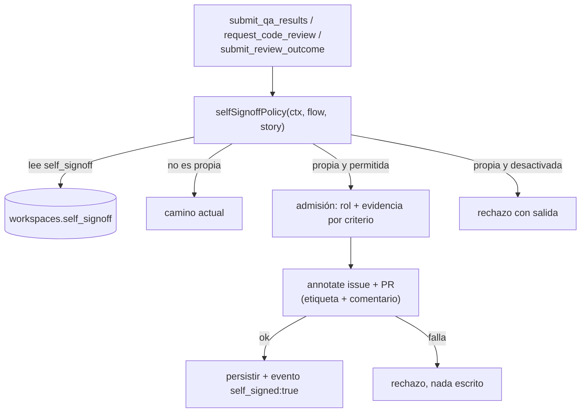

# RFC: QA y code review propios por proyecto, con registro explícito

**Autores:** vazquez.n.g@gmail.com
**Fecha:** 2026-11-24
**Estado:** draft
**PRD origen:** https://docs.google.com/document/d/1QXBtQI_2MIlU1k7cJ9826uYpJLA75xCIdlmrlCVgjh0/edit?usp=drivesdk

## Context

El PRD pide que quien implementa una historia pueda firmar su propio QA y su propio code review, permitido por defecto en cada proyecto y desactivable por un admin donde haya equipo, con cada firma propia marcada en el historial, en el issue y en el PR. Hoy tres guardas lo impiden: `assertNotSelfSignoff` en `submit_qa_results` y `submit_review_outcome`, y `findAuthorAmongReviewers` en `request_code_review`. Las historias #6, #7 y #12 de `sdlc-repo-onboarding` están trabadas por esto.

Revisar el código mostró dos restricciones de GitHub que el diseño tiene que absorber: el autor de un PR no puede aprobarlo (`POST /pulls/{n}/reviews` con `APPROVE` responde 422) ni pedirse review a sí mismo. Sin manejarlas, la firma propia de review fallaría en el adapter aunque el server la acepte.

## Architecture context

Extiende el server existente: una columna de configuración por workspace, una política central que reemplaza las tres guardas, y una capacidad nueva de los adapters para etiquetar y comentar.

### Architecture mode

`reuse`. No hay componentes nuevos: se extienden el `AdminStore` (configuración por workspace), las tres tools de verificación y los adapters de task system y PR provider. La regla "assignee ≠ firmante" pasa de estar hardcodeada en tres lugares a una política única que consulta la configuración del workspace en el momento de firmar.

### Existing components reused

- `apps/server/src/mcp/tools/role-guard.ts` (`assertNotSelfSignoff`): se reemplaza por la política nueva; `assertRole` no cambia.
- `apps/server/src/mcp/tools/submit-qa-results.ts`, `request-code-review.ts`, `submit-review-outcome.ts`: consumen la política.
- `apps/server/src/admin/*` (`AdminStore`, rutas `/admin/api/workspaces`): guarda y expone la configuración.
- `apps/admin` (SPA del panel): toggle por workspace.
- `packages/adapters-contracts` (`PullRequestAdapter`, `TaskSystemAdapter`) y sus implementaciones GitHub, Azure DevOps, Linear e in-memory.
- `apps/server/src/validation/qa-envelope.ts`: la evidencia por criterio no cambia.
- Runner de migraciones (`apps/server/migrations`, siguiente libre: `0015`; `0014` la toma el PR #18).

### Codebase context

- Monorepo pnpm + turbo, TypeScript ESM, vitest, dependency-cruiser (`tools-no-tocan-adapters`: las tools llegan al adapter por el provider).
- Las tools devuelven `{ ok:false, error }` en vez de tirar; la admisión corre antes de cualquier side effect (patrón de `submit_qa_results`).
- Mensajes en español; comentarios largos explican el porqué.

### Integration points

- **`AdminStore.getWorkspace`** devuelve `self_signoff: boolean`; nuevo `setSelfSignoff(workspaceId, enabled, actor)`.
- **`PUT /admin/api/workspaces/:id/settings`** `{ self_signoff: boolean }` (sesión de admin).
- **`PullRequestAdapter.annotate(ref, { labels, body })`** y **`TaskSystemAdapter.annotate(id, { labels, body })`**: etiqueta + comentario.
- **`PullRequestAdapter.submitOutcome`** acepta `as_author: true`: en GitHub publica la review con `event: "COMMENT"`.
- **`submit_qa_results`**: cada resultado acepta `screenshots?: string[]` (URLs https).
- **Eventos**: `qa.results.submitted` y `review.outcome.submitted` llevan `self_signed: boolean`.
- **`whoami` / `get_flow_state`**: exponen `self_signoff` del workspace.

## Goals

- Las tres tools aceptan la firma del assignee cuando el workspace tiene `self_signoff=true` (default), y la rechazan con un mensaje accionable cuando es `false`.
- Las historias #6, #7 y #12 de `sdlc-repo-onboarding` se cierran por el flow sin cambios en sus datos (la regla se evalúa al firmar).
- 100% de las firmas propias dejan etiqueta y comentario en el issue y en el PR antes de persistirse; si la anotación falla, la firma se rechaza sin escribir nada.
- Leer la configuración agrega < 5 ms p95 a las tools de firma (un lookup por PK).
- Cada cambio de configuración queda auditado con actor, fecha, valor anterior y nuevo.

## Non-goals

- Configuración por flow o por historia, o declarada en `sdlc.config.yaml`.
- Desactivar o alertar al sumar miembros a un workspace.
- Generar screenshots desde el server o subir archivos: el server sólo referencia URLs que adjunta quien firma.
- Cambiar la regla de roles (`assertRole`) o la validación de evidencia.
- Branch protection de GitHub: si un repo exige aprobaciones para mergear, eso se ajusta en GitHub (ver Risks).

## Design

La firma propia se decide en un solo lugar, en el momento de firmar, y siempre deja rastro afuera antes de dejarlo adentro.
Las tres tools comparten la misma política y el mismo renderer del comentario; lo único que cambia entre ellas es la etiqueta y el adapter que se llama al final.
La admisión existente (roles, envelope, evidencia) no se toca: la política sólo decide si el assignee puede ser quien firma.

### Architecture overview


Fuente del diagrama (Mermaid):



**Política (`apps/server/src/mcp/tools/self-signoff.ts`):**

```ts
type SelfSignoff =
  | { self: false }                          // firma otra persona: camino actual
  | { self: true; allowed: true }
  | { self: true; allowed: false; error: string };

async function selfSignoffPolicy(adminStore, ctx, flow, story): Promise<SelfSignoff>;
```

- `self` = `story.assignee === ctx.userId`.
- Workspace sin registro en el `AdminStore` (dev in-memory) → `allowed: true`, el default del PRD.
- Error leyendo el store → `allowed: false` (fallar cerrado en la lectura).
- Kill switch global `SELF_SIGNOFF_ENABLED=false` → `allowed: false` en todos los workspaces.

**Por tool:**

1. **`submit_qa_results`**: reemplaza `assertNotSelfSignoff` por la política. La admisión (rol, envelope, cobertura N/M completa, evidencia por caso) es la misma. Con `self && allowed`, después de admitir y antes de persistir, anota issue y PR con la etiqueta `sdlc:qa-propio` y el comentario de detalle.
2. **`request_code_review`**: si `reviewer_ids` incluye al autor y la firma propia está permitida, no llama a `requestReview` en el provider (GitHub rechaza pedirle review al autor). Registra `review.requested` con `self_review: true` y avanza la fase igual. Con reviewers ajenos el camino es el actual.
3. **`submit_review_outcome`**: reemplaza `assertNotSelfSignoff` por la política. Con `self && allowed` anota con `sdlc:review-propio` y llama a `submitOutcome({ ..., as_author: true })`: GitHub publica una review `COMMENT` con el detalle en vez de `APPROVE`. Los dos ejes del review envelope se exigen igual.

**Comentario de detalle** (lo arma `renderSelfSignoffComment`, mismo texto en issue y PR):

```md
### QA propio — firmado por vazquez.n.g@gmail.com
Story #6 · flow default:sdlc-mcp:sdlc-repo-onboarding · 2026-11-24T15:00:00Z
Comando: `pnpm --filter @sdlc/cli test` · exit 0 · sha256:…

| Criterio | Resultado | Evidencia |
|---|---|---|
| AC-1 … | passed | [corrida](https://github.com/.../runs/1) |


```

### Data model

```sql
-- 0015_self_signoff.sql (aditiva)
ALTER TABLE "workspaces" ADD COLUMN IF NOT EXISTS "self_signoff" boolean NOT NULL DEFAULT true;

CREATE TABLE IF NOT EXISTS "workspace_settings_audit" (
  "id" bigserial PRIMARY KEY,
  "workspace_id" text NOT NULL,
  "setting" text NOT NULL,          -- 'self_signoff'
  "old_value" jsonb NOT NULL,
  "new_value" jsonb NOT NULL,
  "actor" text NOT NULL,            -- email del admin
  "created_at" timestamptz NOT NULL DEFAULT now()
);
CREATE INDEX IF NOT EXISTS "workspace_settings_audit_ws" ON "workspace_settings_audit" ("workspace_id", "created_at");
```

`setSelfSignoff` hace el UPDATE y el INSERT de auditoría en la misma transacción, y no escribe auditoría si el valor no cambia.

`StoryQaResult` suma `screenshots?: string[]` (máx. 5 por caso, https, mismas reglas de host que `evidence_url`).

### API / Contracts

```ts
// packages/adapters-contracts
interface Annotation { labels: string[]; body: string }
interface PullRequestAdapter {
  annotate(ref: PullRequestRef, a: Annotation, ctx: TenantCtx): Promise<void>;
  submitOutcome(input: SubmitOutcomeInput & { as_author?: boolean }, ctx: TenantCtx): Promise<void>;
}
interface TaskSystemAdapter {
  annotate(id: string, a: Annotation, ctx: TenantCtx): Promise<void>;
}
```

- GitHub (issues y PR): `POST /repos/{o}/{r}/issues/{n}/labels` + `POST /repos/{o}/{r}/issues/{n}/comments`. La etiqueta se crea si no existe (`POST /labels`, 422 = ya existe).
- Azure DevOps: tag en el work item + comentario; en el PR, thread con el detalle y label del PR.
- Linear: label + comentario.
- In-memory: guarda las anotaciones para los tests.

```http
PUT /admin/api/workspaces/:id/settings
{ "self_signoff": false }
→ 200 { "workspace_id": "sdlc-mcp", "self_signoff": false }
```

`whoami` y `get_flow_state` agregan `self_signoff` por workspace.

### Security

- **Default permitido** por decisión de producto (PRD). Fallar cerrado aplica a la lectura: si el store falla, se rechaza la firma propia.
- **Aislamiento**: la política lee sólo `flow.project`, el mismo workspace que ya validan `resolveStoryForCtx` y `assertRole`; ningún parámetro de la tool elige el workspace.
- **Quién cambia la configuración**: sólo la ruta admin, con la sesión de admin existente. Ninguna tool MCP la escribe.
- **Roles intactos**: QA sigue exigiendo `qa|tech-lead` y review `reviewer|tech-lead`. Sólo se relaja "assignee ≠ firmante".
- **Screenshots**: el server no descarga ni sube nada; valida que sean URLs https con las reglas de host de la evidencia (sin localhost ni example.com).
- **Orden de side effects**: anotar afuera antes de persistir, para que no exista una firma propia registrada sin marca visible.

### Performance

- La política agrega un `SELECT self_signoff FROM workspaces WHERE workspace_id = $1` por firma: < 5 ms p95.
- La anotación agrega 2–4 requests a GitHub por firma propia (etiqueta y comentario en issue y PR). Las tools de firma se llaman pocas veces por historia; el costo es aceptable frente al requisito de trazabilidad.

## Alternatives considered

1. **Que el assignee firme con otra identidad (cuenta secundaria o rol "verificador")** — Descartada: es el mismo control disfrazado y no deja la marca que pide el PRD.
2. **Flag en `sdlc.config.yaml` por workspace** — Descartada para el MVP: el reconcile del archivo sólo crea entidades (no actualiza), así que habría dos fuentes de verdad para un valor que cambia; el PRD pide que lo cambie un admin y quede auditado.
3. **Permitir sólo QA propio y dejar el review con la regla actual** — Descartada: las historias se volverían a trabar en `request_code_review` (decisión del usuario en el PRD).
4. **Aprobar el PR con un token de bot distinto del autor** — Descartada: agrega un secreto y una identidad nueva por instalación, y la aprobación seguiría siendo de la misma persona; la review `COMMENT` con la etiqueta dice la verdad.

## Risks

| Riesgo | Tipo | Probabilidad | Impacto | Mitigación |
|---|---|---|---|---|
| Un repo con branch protection que exige una aprobación no se puede mergear después de un review propio `COMMENT` | integ | H | M | Documentar en el runbook: en repos de una persona, no exigir aprobaciones; el comentario `sdlc:review-propio` es el registro. `doctor` (#14) puede avisarlo más adelante |
| Falla GitHub al anotar y la firma propia queda rechazada aunque la evidencia esté bien | integ | M | L | Mensaje con el error del provider; reintentar la misma tool es idempotente (la etiqueta ya existente no falla) |
| Un admin olvida desactivarlo en un proyecto de cliente con equipo | sec | M | H | Valor visible en el panel y en `whoami`; checklist de alta de proyectos; cada firma propia queda marcada en el PR |
| Error al leer el store bloquea firmas propias de todos | integ | L | M | Mensaje explícito; el kill switch y el valor por workspace se pueden corregir sin redeploy |
| Comentario duplicado si se reintenta tras una falla parcial (issue ok, PR falla) | data | M | L | El comentario lleva un marcador oculto con el story_id y el tipo de firma; el adapter actualiza el comentario existente en vez de crear otro |

## Rollout

- **Fase 1 (dev local, in-memory)**: tests de las tres tools con `self_signoff` en true y false, de las anotaciones y del render del comentario. Avanza con la suite verde.
- **Fase 2 (instancia nigav, workspace `sdlc-mcp`)**: aplicar `0015`, firmar QA y review propios de #6, #7 y #12. Avanza si las tres llegan a `merged` con etiqueta y comentario en issue y PR y `self_signed:true` en los eventos.
- **Fase 3 (100%: todos los workspaces de nigav)**: el default ya los cubre. Gate: una semana sin historias trabadas por falta de firmante (métrica del PRD).

## Rollback

1. Para cortar la firma propia en toda la instancia sin redeploy de código: setear `SELF_SIGNOFF_ENABLED=false` en `infra/.env.local` y `docker compose --env-file infra/.env.local -f infra/compose.yml up -d server`. Las tres tools vuelven a rechazar al assignee.
2. Para cortarla en un solo workspace: panel admin → Workspaces → desactivar "QA y review propios", o `PUT /admin/api/workspaces/{id}/settings {"self_signoff":false}`.
3. Para volver el código atrás: `git revert` del merge de la épica y desplegar. La migración `0015` es aditiva y se deja aplicada; si hiciera falta: `ALTER TABLE workspaces DROP COLUMN self_signoff; DROP TABLE workspace_settings_audit;`.
4. Las firmas propias ya hechas no se deshacen: quedan en eventos, issues y PRs, que es el registro que pide el PRD.

## Observability

- **Métricas** (OTel):
  - `signoff.total` (counter por `tool`, `self=true|false`, `result=accepted|rejected`);
  - `signoff.self_rejected` (counter por `reason=disabled|store_error|annotate_failed`);
  - `signoff.annotate.latency_ms` (histograma por provider).
- **Logs** (pino): `{ evt: "signoff", tool, workspace_id, story_id, self, allowed, result, reason }`. Sin tokens ni contenido del comentario.
- **Auditoría**: `workspace_settings_audit` para cambios de configuración; eventos del flow con `self_signed`.
- **Alertas** (revisión manual en el MVP): cualquier `signoff.total{self=true,result=accepted}` en un workspace con `self_signoff=false` (no debería existir); `annotate_failed` > 3 por día.

## ADRs

- ADR-0003: La separación implementar/verificar pasa a ser configuración por workspace, permitida por defecto.

## Open Questions

- ¿Hace falta avisar desde `sdlc doctor` (#14) cuando el repo tiene branch protection con aprobaciones obligatorias y el workspace usa review propio? Dueño: Nicolas Vazquez. Fecha: 2026-12-01.
